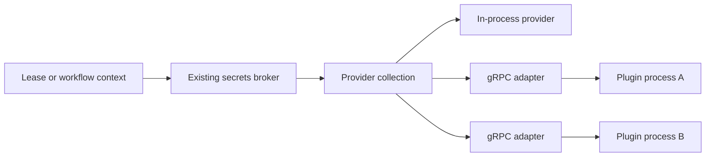

# Secret provider plugins and collections

Status: implemented. Scope: `jobdb.SecretProvider`.

Support separately built secret providers through HashiCorp `go-plugin`, and
support collections in which every provider participates in each resolution.
Both features fit behind the existing interface; runtime injection points and
lease/workflow method signatures can stay unchanged. Add an optional
`providerId` field to each resolved value for provenance.

The proposal adds two independent adapters:

- `secretplugin.Start(...)` returns a process-backed `jobdb.SecretProvider`.
- `secretproviders.New(...)` returns a collection implementing the same interface.
  Its members can be plugins, ordinary Go providers, or a mixture.

The packages and configuration below are implemented. The snippets in this
design remain pseudocode; use the [provider guide](GUIDE-SECRET-PROVIDERS.md)
and [compilable example](../examples/secret-provider/main.go) for authoring.

## Existing integration point

The contract in [`pkg/jobdb/secrets.go`](../pkg/jobdb/secrets.go) is already small:

```go
type SecretProvider interface {
    ResolveSecrets(context.Context, SecretResolveRequest) (SecretResolveResult, error)
}
```

A request contains tenant, job, verified optional principal, authoritative job
metadata, and requested names. A response contains allowed values with optional
versions, expiration times, and the lease-bound flag. Providers omit unknown or denied names; any
error discards the entire result.

The existing [secrets broker](../pkg/jobdb/internal/secretsbroker/broker.go)
checks the lease before and after resolution, bounds lookup time, validates
results, and sanitizes errors. Keep that broker outside both adapters:



Inject the resulting provider using existing `sqlite.Config.SecretProvider`,
`toy.WithSecretProvider`, or `runtimecore.Config.SecretProvider`. Remote workers
continue calling their JobDB server; plugin processes run alongside that server.

## Collection semantics

Recommend first-provider-wins precedence. A collection is an immutable ordered
list of members with unique, nonempty IDs and non-nil providers. Earlier members
have higher priority, independently for each requested name.

| Situation | Behavior |
| --- | --- |
| Ordinary lookup | Call every member with the full request, using bounded concurrency and the same overall deadline. |
| Earlier provider supplies every name | Still call the remaining providers. |
| Providers return different names | Merge all returned names into one result. |
| Provider omits a name | It contributes nothing for that name. |
| Multiple providers return the same name | Use the first provider in configured order that returns it, independent of completion order. |
| Provider returns an empty string | This is a present value and wins over later providers. |
| Any member returns an error | Discard all values. Collect the other outcomes until completion or deadline. |
| Deadline or cancellation | Cancel outstanding work and return no values; do not begin queued calls after cancellation. |
| All providers return empty results | Return an empty result successfully. |
| Empty collection or duplicate member IDs | Reject configuration during construction. |

For example, a request for `github_token` and `database_password` goes to both
the GitHub provider and the database provider. Each contributes its own value.
If the database provider also returns `github_token`, the earlier GitHub
provider wins. Select its entire entry, including value, version, expiration,
and any lease-bound metadata; never combine fields from different providers.

Lookup latency depends on the slowest member, plus any queuing, and successful
resolution requires every member to be available. These are deliberate costs
of collecting and validating all responses; version 1 has no best-effort mode.

Every provider's response must independently satisfy the existing contract:
only requested names, valid UTF-8, unexpired values, and bounded size. Validate
the merged response too, including expiration at delivery and the total response
limit. A collection must not multiply the caller's response allowance. Clone
mutable request fields for each member and return an owned result. Bound the
number of in-flight and buffered member responses together, and merge in
configured order. Apply the aggregate size limit to selected entries, including
provenance, rather than adding the sizes of shadowed entries. If the selected
output exceeds its limit, discard values while collecting remaining outcomes.

Use existing safe error classes. On an overall timeout, return
`ErrSecretsUnavailable`. Otherwise choose the first member error in configured
order; if all members succeeded but merging fails, return
`ErrSecretResolutionFailed`. Diagnostics may identify configured member IDs and
safe failure categories, but must exclude values and raw provider errors.

**Authorization is a union of independent grants.** The current interface does
not distinguish “unknown” from “denied,” so an omission cannot veto another
provider. If A omits `token` and B authorizes and returns it, the collection
returns B's value. All configured members must be trusted to grant access within
their intended name space. A central veto policy would require an explicit
policy layer or a richer contract; do not infer one from omissions. Precedence
selects among authorized contributions; it does not create a denial veto.

No collection cache is added. Existing workflow attempt caching still applies:
“all providers respond” describes each actual provider resolution, not every
workflow call satisfied from its cache. Values from different providers do not
constitute an atomic cross-provider snapshot.

## Verified lease authority

The current request includes `Lease SecretLeaseContext`, carrying `LeaseID`,
`WorkerID`, `LeaseExpiresAt`, and `AuthorizedNotAfter`. Preserve all four through
collection copies and protobuf round trips, alongside tenant, job, principal,
and application metadata. No lease token crosses the provider boundary.

`AuthorizedNotAfter` is the earlier of the backend lease expiry and the
presenting capability's expiry. A renewed backend lease must not extend the
rights of an older token. Providers mint dynamic credentials with expiry encoded
in the credential itself at or before this bound, and return `LeaseBound: true`
with that same `ExpiresAt`. Missing authority cannot authorize issuance.
`ctx.Deadline()` bounds lookup execution, not credential lifetime.

Validate lease-bound results from every member, including shadowed entries,
against the supplied authority. The broker still revalidates the live lease
and bounds after the whole collection resolves. Do not clamp credential metadata
to hide a credential that actually lives too long. Static SQLite values remain
unmarked and retain their existing semantics. Test both kinds together, including
older capabilities after renewal, cancellation during plugin I/O, and fresh
workflow reads that update provenance without changing cached-read behavior.

## Provider provenance

Add a field to the existing `jobdb.SecretValue`:

```go
ProviderID string `json:"providerId,omitempty"`
```

The collection assigns the winning member's configured ID, such as `local` or
`github`. It overwrites any member-supplied value for this field; provenance
identifies the host's selected member, not an identity claimed by a plugin.
Use stable, non-secret IDs that distinguish configured instances, even when
they run the same executable. IDs must not contain credentials or connection
strings. If collections are nested, this field identifies the outer configured
member; a nested provenance path is outside version 1.

For `[local, external]`, a locally supplied `github_token` carries
`ProviderID: "local"`. If local omits it, the external value carries
`ProviderID: "external"`. Omitted names have no provenance entry.

Preserve the tag through embedded results, HTTP responses, workflow result
copies, and attempt caches. Refresh replaces value and provenance together;
deleting a local override changes the source on the next fresh/uncached lookup,
not retroactively in an existing cached result. Keep the provider's own `Version`
field separate from `ProviderID`.

Update the public OpenAPI schema and generated response models for the optional
field. Existing Go HTTP clients use `json.Unmarshal` and can ignore it; updated
clients should accept responses without it from older servers or directly
injected providers. Normal configured collections, including one-member
collections, always stamp it. No plugin response field is needed: JobDB adds
provenance after receiving the plugin's result.

For later debugging, support structured resolution diagnostics with job identity,
secret name, and selected provider ID. Never include the secret value, raw plugin
errors, or full result objects. Provenance remains available to callers even
when diagnostics are disabled. Secret responses still do not become chapters;
historical source lookup uses those diagnostics rather than re-resolving a name
whose source may have changed.

## Plugin transport and contract

Use local subprocesses with gRPC through `github.com/hashicorp/go-plugin`.
HashiCorp supplies process startup, handshake, and connection management; JobDB
must implement the RPC adapters for its interface. This is a local plugin
transport, not a way to host providers on remote machines.
[HashiCorp architecture and usage](https://github.com/hashicorp/go-plugin#architecture).

Define `jobdb.secrets.plugin.v1.SecretProvider.ResolveSecrets` in a dedicated
protobuf file, separate from the persisted chapter/storage protocol:

```proto
service SecretProvider {
  rpc ResolveSecrets(ResolveRequest) returns (ResolveReply);
}

message ResolveRequest {
  string tenant_id = 1;
  string job_id = 2;
  optional string principal = 3;
  bytes app_metadata_json = 4;
  repeated string names = 5;
  LeaseContext lease = 6;
}

message LeaseContext {
  string lease_id = 1;
  string worker_id = 2;
  google.protobuf.Timestamp lease_expires_at = 3;
  google.protobuf.Timestamp authorized_not_after = 4;
}

message SecretValue {
  optional string value = 1;
  string version = 2;
  google.protobuf.Timestamp expires_at = 3;
  bool lease_bound = 4;
}

message ResolveResult { map<string, SecretValue> secrets = 1; }

message ResolveReply {
  oneof outcome {
    ResolveResult result = 1;
    Failure failure = 2;
  }
}
// Failure carries a closed enum of existing safe provider error categories,
// with no free-form message, cause, or backend response body.
```

Preserve nil versus present principal, raw metadata bytes, empty secret values,
versions, and optional timestamp presence. The protobuf definition needs the
usual syntax/package/import declarations, omitted above. The failure enum maps
to existing errors such as unavailable, resolution failed, invalid request,
request too large, and no provider configured; unknown categories or a missing
outcome are invalid responses. A result and error cannot coexist on the wire.

Pass the caller's context through the generated gRPC client into the provider.
Do not replace it with `context.Background()`. The adapter must also terminate
calls when its plugin process exits. Deadline/cancellation and unavailable
connections map to `ErrSecretsUnavailable`; malformed or oversized responses
map to `ErrSecretResolutionFailed`. Never return raw gRPC status text or details.

Validate at both sides of the adapter, and retain broker validation. Put explicit
gRPC message bounds on requests and responses before decoding. These are
separate from the existing name-list and JSON-result limits: the request envelope
also contains job metadata, and protobuf size is not JSON size. The default envelope limit is
8 MiB, configurable on both SDK sides; excess is rejected safely.

Use the dispense name `secret_provider`, a JobDB-specific handshake cookie, and
application protocol version 1 through `VersionedPlugins`. This version is
independent of `ExecutionPatternVersion`. Incompatible versions fail at startup;
additive protobuf changes remain compatible. The implementation pins `go-plugin`
v1.8.0. The SDK supplies both `plugin.GRPCPlugin` methods and embeds
`plugin.NetRPCUnsupportedPlugin` to disable net/rpc.
[HashiCorp plugin interfaces](https://github.com/hashicorp/go-plugin/blob/main/plugin.go).

## Startup, ownership, and failure behavior

Start one long-lived process per configured plugin entry and reuse its connection
for concurrent requests. Bound per-process in-flight calls across all jobs;
waiting for a slot consumes the request's existing deadline. Backend clients
inside the plugin must support concurrent calls. Enforce admission inside the
plugin too, holding a slot until its provider call actually returns, so a backend
that ignores cancellation cannot accumulate unlimited work.

`secretplugin.Start(startCtx, config)` completes the handshake and dispenses the
provider before succeeding. Bound the entire startup, including connection and
dispense, and clean up the child on every failure. The startup context controls
startup only; a successful process lives until its explicit `Close()`.

The executable constructs and configures its backend before calling `Serve`.
Backend-specific arguments or a plugin-owned configuration file are sufficient
for version 1; no generic configuration RPC is needed. Start every required
plugin before accepting requests. Invalid configuration or a failed startup
aborts startup and closes any providers already opened.

The process handle implements `SecretProvider` and a separate idempotent
`Close()`. Preserve existing ownership: runtimes do not close injected providers,
and the collection does not close its members. The application owns opened
stores and plugin handles. Drain/cancel requests, close the runtime, then close
providers; cleanup must also run if HTTP listener creation fails.

On a plugin crash, fail affected lookups without returning partial collection
results. A subsequent lookup may restart the child through a serialized,
bounded-backoff restart path; concurrent calls must not spawn competing copies.
Do not automatically replay the failed lookup: providers may issue credentials
or perform audit writes. Restarting preserves configuration and does not add
members or substitute providers. Hot reload and process reattachment are outside
the initial implementation.

Execute a configured absolute path directly with an argument array. Plugin
selection belongs to server/operator configuration, never job data or tenant
configuration. Use gRPC-only negotiation and `AutoMTLS`, with explicitly allowed
environment variables (`SkipHostEnv`); optional expected checksums use
`SecureConfig`. Disable automatic forwarding of child output into application
logs and emit safe lifecycle diagnostics separately. HashiCorp exposes these
controls in [`ClientConfig`](https://github.com/hashicorp/go-plugin/blob/main/client.go).
The handshake cookie only detects accidental invocation; it does not authenticate
code. [Handshake contract](https://github.com/hashicorp/go-plugin/blob/main/server.go).
Plugin executables remain trusted server code; subprocess isolation is not a
sandbox. Lease tokens are never sent to plugins.

## Configuration and defaults

The server flag `--secret-providers-file` is available for the default SQLite command,
`jobdb sqlite`, and `jobdb toy`. Other runtime hosts can use the Go adapters.
Use a versioned JSON file with explicit members, for example:

```json
{
  "version": 1,
  "max_parallel": 4,
  "providers": [
    {
      "id": "github",
      "type": "plugin",
      "command": "/opt/jobdb/plugins/github-secrets",
      "args": ["--config", "/etc/jobdb/github-secrets.json"],
      "pass_env": ["SSL_CERT_FILE"]
    },
    {
      "id": "database",
      "type": "plugin",
      "command": "/opt/jobdb/plugins/database-secrets",
      "args": ["--config", "/etc/jobdb/database-secrets.json"]
    }
  ]
}
```

The file can also select `type: "sqlite"` with an explicit secrets database path
to include the existing development provider. Credentials for external providers
belong in the plugin's own protected configuration or workload identity, not
command arguments.
Validate the whole file before spawning anything, reject unknown fields, and
require unique IDs and at least one member. Start/close handles in the CLI layer.

Without this flag, preserve current behavior: SQLite opens its default development
store and toy has no provider. With the flag, use exactly the configured
collection, including a collection of one. Do not silently add SQLite's automatic
store or fall back to it after a plugin failure. Such a fallback could grant a
name another provider deliberately omitted.

### Development: built-in SQLite plus an external provider

**Using the built-in SQLite secrets repository alongside an external provider is
an explicitly supported development configuration.** Both contribute to every
resolution. The SQLite member uses the existing `sqlitesecrets.Store`; pointing
it at `jobdb.db.secrets.db` reuses the normal development secrets repository.

```json
{
  "version": 1,
  "development_admin_provider": "local",
  "providers": [
    {
      "id": "local",
      "type": "sqlite",
      "path": "./jobdb.db.secrets.db"
    },
    {
      "id": "external",
      "type": "plugin",
      "command": "/opt/jobdb/plugins/github-secrets",
      "args": ["--config", "/etc/jobdb/github-secrets.json"]
    }
  ]
}
```

With this configuration, `jobdb secrets set/remove` on the same server continues
to manage the local SQLite store. Reads use the collection: for example, a local
`test_api_key` and an external `github_token` are returned together. Because
`local` is listed first, a locally supplied `github_token` overrides the external
one and is tagged `providerId: "local"`. Removing that override exposes the
external value on the next fresh/uncached lookup.

`development_admin_provider` must name a configured built-in SQLite member.
Keep this write target separate from the aggregate read provider: the CLI retains
the selected store handle and exposes the existing `SetDevSecret` and
`RemoveDevSecret` methods through its server wiring, preserving their validation
and limits. This can use a runtime wrapper without changing `SecretProvider` or
adding plugin write RPCs. Writes never fan out to external providers.

Without an explicit admin target, an injected collection does not enable
development administration. The existing no-file SQLite default keeps its
current administration behavior. General administration of external providers
remains provider-specific.

## Pseudocode: author a plugin

The author implements the existing provider interface and calls the
SDK's `Serve`. Backend and policy types below stand in for the author's own code.

```go
package main

// Imports omitted: context, jobdb, and
// secretplugin "github.com/colony-2/jobdb/pkg/jobdb/secrets/plugin".

type GitHubSecrets struct {
    backend *CredentialBackend // concurrency-safe
    policy  *AccessPolicy
}

func (p *GitHubSecrets) ResolveSecrets(
    ctx context.Context, req jobdb.SecretResolveRequest,
) (jobdb.SecretResolveResult, error) {
    out := jobdb.SecretResolveResult{
        Secrets: map[string]jobdb.SecretValue{},
    }
    for _, name := range req.Names {
        if err := ctx.Err(); err != nil {
            return jobdb.SecretResolveResult{}, err
        }
        if name != "github_token" {
            continue // This provider does not own the name.
        }
        allowed, err := p.policy.Allow(
            ctx, req.TenantID, req.JobID, req.Principal, req.AppMetadata, name,
        )
        if err != nil {
            return jobdb.SecretResolveResult{}, jobdb.ErrSecretsUnavailable
        }
        if !allowed {
            continue // Denials are omissions, not errors.
        }
        if req.Lease.AuthorizedNotAfter.IsZero() {
            return jobdb.SecretResolveResult{}, jobdb.ErrSecretResolutionFailed
        }
        // The issuer must enforce this expiry in the actual credential.
        credential, found, err := p.backend.Issue(
            ctx, req.TenantID, name, req.Lease,
        )
        if err != nil {
            // Example backend classifies all its lookup failures as transient.
            return jobdb.SecretResolveResult{}, jobdb.ErrSecretsUnavailable
        }
        if !found {
            continue
        }
        out.Secrets[name] = jobdb.SecretValue{
            Value: credential.Value, Version: credential.Version,
            ExpiresAt: credential.ExpiresAt, LeaseBound: true,
        }
    }
    return out, nil
}

func main() {
    cfg := loadPluginConfigFromFlags() // Validates or exits with a safe error.
    backend := openBackend(cfg)       // Initializes before the handshake.
    policy := loadPolicy(cfg)
    secretplugin.Serve(&GitHubSecrets{backend: backend, policy: policy})
}
```

`Serve` supplies the adapters, handshake, bounded gRPC server, and safe error
encoding. Internally its structure is:

```go
plugin.Serve(&plugin.ServeConfig{
    HandshakeConfig: jobdbSecretHandshake,
    VersionedPlugins: map[int]plugin.PluginSet{
        1: {"secret_provider": &GRPCAdapter{Impl: provider}},
    },
    GRPCServer: newBoundedGRPCServer, // Preserves go-plugin's supplied TLS options.
})
// GRPCAdapter embeds plugin.NetRPCUnsupportedPlugin.
// GRPCServer registers the generated service around Impl.
// GRPCClient returns a jobdb.SecretProvider proxy using each call's context.
```

## Pseudocode: compose and inject providers

```go
func run(ctx context.Context) error {
    github, err := secretplugin.Start(ctx, secretplugin.ProcessConfig{
        Command: "/opt/jobdb/plugins/github-secrets",
        Args: []string{"--config", "/etc/jobdb/github-secrets.json"},
    })
    if err != nil { return err }
    defer github.Close()

    database, err := secretplugin.Start(ctx, secretplugin.ProcessConfig{
        Command: "/opt/jobdb/plugins/database-secrets",
        Args: []string{"--config", "/etc/jobdb/database-secrets.json"},
    })
    if err != nil { return err }
    defer database.Close()

    limits := jobdb.SecretLimits{}.WithDefaults()
    collection, err := secretproviders.New([]secretproviders.Member{
        {ID: "github", Provider: github},
        {ID: "database", Provider: database},
        // An ordinary Go provider can be added with the same Member type.
    }, secretproviders.Options{MaxParallel: 4, Limits: limits})
    if err != nil { return err }

    runtime, err := sqlite.NewFromConfig(ctx, sqlite.Config{
        DBPath: "jobs.db", SecretProvider: collection, SecretLimits: limits,
    })
    if err != nil { return err }
    defer runtime.Close(context.Background())
    return serveAndDrain(ctx, runtime)
}
```

The collection algorithm is deliberately simple:

```text
validate request; establish the shared lookup deadline
dispatch one call per member, bounding in-flight and buffered responses together
    give each member its own copy of the request
    collect a validated response or safe error in that member's slot
    do not cancel siblings merely because one member failed
consume completed slots in configured order
    select each name only if an earlier member has not supplied it
    stamp the selected entry with that member's configured ProviderID
    discard values and mark failure if selected output exceeds the size limit
continue collecting all outcomes, or cancel when the shared deadline expires
if any member failed: return an empty result and deterministic safe error
if selected output exceeded the limit: return an empty result and safe error
revalidate expiration and return the merged result
```

Providers that ignore cancellation still violate the existing Go contract.
Process-backed calls can be interrupted at the RPC boundary; an arbitrary
in-process Go implementation cannot be forcibly stopped. Bound dispatch and
cleanup so cancellation does not accumulate abandoned calls or restart loops.

## Implementation and acceptance coverage

| Area | Implementation and checks |
| --- | --- |
| Collections | `pkg/jobdb/secrets/providers`: all-member invocation, first-wins selection independent of completion order, error handling, request isolation, limits, cancellation, and host-assigned provenance. |
| Transport | `pkg/jobdb/secrets/plugin`: actual subprocess handshake, lease context and credential bounds, malformed messages, safe errors, startup cancellation, crash/restart, environment isolation, and close. |
| Runtime integration | SQLite/toy over embedded/HTTP transports; local static overrides plus dynamic credentials, old capabilities after renewal, lease revocation, workflow caches, and fresh reads. |
| CLI | Explicit provider configuration, selected local admin store, preserved lease renewal, cleanup on startup/listener failure, and draining requests before provider shutdown. |
| Authoring | [Provider guide](GUIDE-SECRET-PROVIDERS.md) and [compilable JWT example](../examples/secret-provider/main.go), including verification that the signed expiry respects lease authority. |
| Compatibility | Optional provenance through HTTP, pinned protobuf generators, and a dependency test preventing ordinary runtime imports from pulling in go-plugin. |

Validation uses Go 1.26.1: the full integration suite, workflow/provider/CLI race
suites, and `go vet` on the provider, CLI, and example packages. CI includes the
provider race checks.

This feature changes neither chapter counts nor replay. Secret resolution remains
live and unrecorded; completed tasks replay their stored outcomes, and offline
replay continues to reject secret reads. Plugin/library versions can evolve
independently of the durable execution-history protocol. No job migration is
needed.
